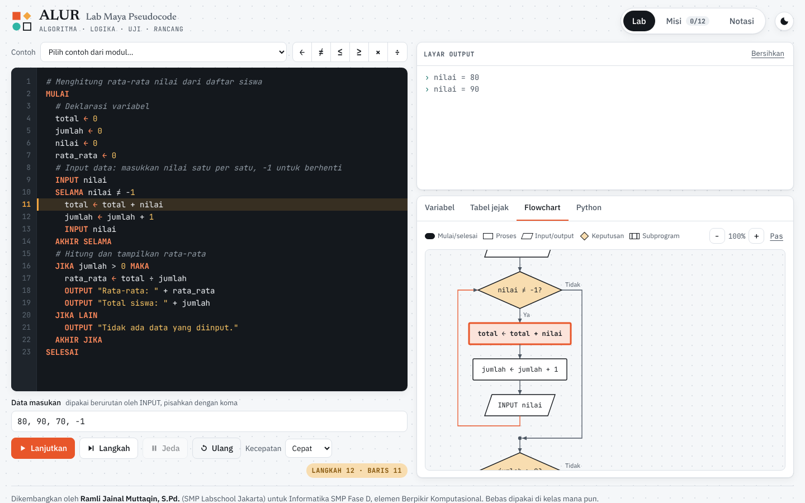
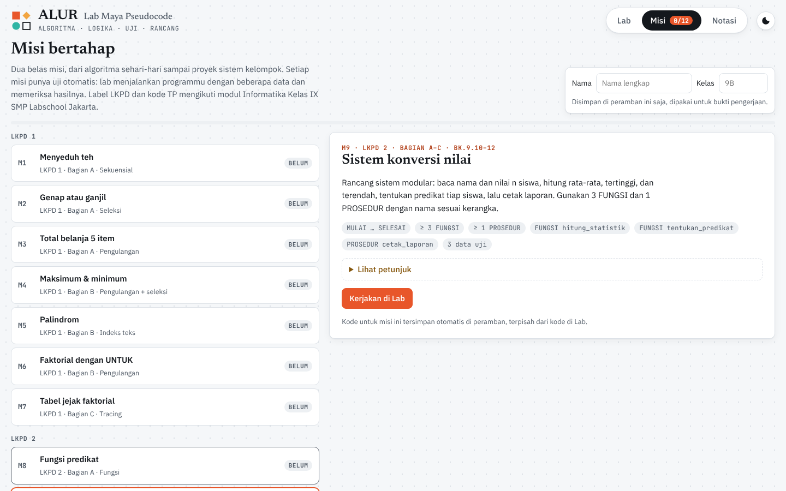
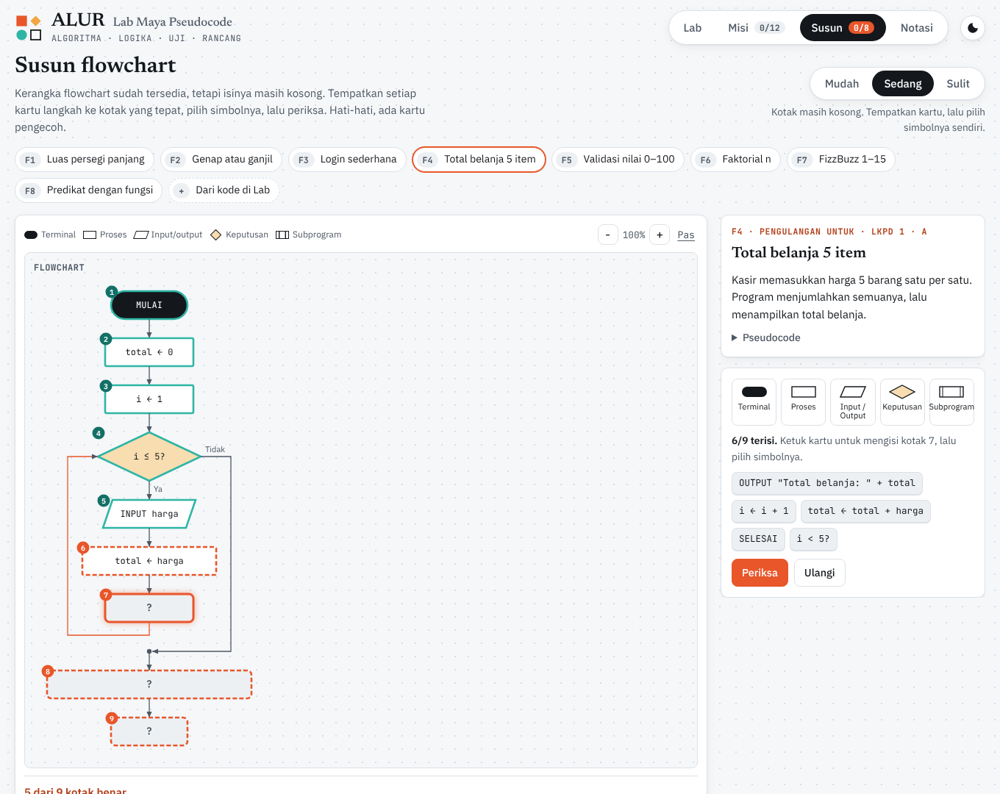

# ALUR · Lab Maya Pseudocode

**ALUR** adalah singkatan dari **A**lgoritma, **L**ogika, **U**ji, **R**ancang: empat kebiasaan yang dilatih saat murid merancang program, sekaligus pengingat pada *diagram alir* (flowchart).

Laboratorium maya untuk belajar **pseudocode berbahasa Indonesia** di SMP (Informatika Fase D, elemen Berpikir Komputasional). Murid menulis pseudocode dengan kata kunci seperti `MULAI`, `JIKA`, `SELAMA`, dan `UNTUK`, lalu menjalankannya langkah demi langkah sambil melihat **nilai variabel, tabel jejak, flowchart, dan versi Python-nya** terbentuk otomatis.

**Coba langsung:** https://ramli-labs.github.io/ALUR/

Bebas dipakai guru dan sekolah mana pun. Dirancang untuk kelas dengan internet terbatas: setelah dibuka sekali, seluruh lab tetap berjalan tanpa internet, dan tidak ada data murid yang dikirim ke server mana pun.



## Fitur

- **Menjalankan pseudocode sungguhan.** `MULAI … SELESAI`, `INPUT`, `OUTPUT`, `JIKA … JIKA LAIN JIKA … AKHIR JIKA`, `SELAMA`, `UNTUK … DARI … HINGGA`, `UNTUK SETIAP … DALAM`, `FUNGSI`/`PROSEDUR` dengan parameter dan `KEMBALIKAN` banyak nilai, array, serta `TAMBAH … KE …`.
- **Mode langkah.** Baris yang sedang dijalankan disorot di editor dan di flowchart. Panel variabel memisahkan variabel program utama dan variabel lokal fungsi, sehingga konsep *scope* terlihat.
- **Tabel jejak otomatis.** Setiap perubahan variabel, hasil kondisi (BENAR/SALAH), INPUT, dan OUTPUT tercatat seperti tabel jejak di LKPD.
- **Flowchart otomatis** dengan simbol standar: terminal, proses, input/output, keputusan, subprogram, dan panah kembali untuk pengulangan.
- **Mode Susun Flowchart.** Murid menyusun sendiri flowchart dari kartu langkah ke kerangka kosong, memilih simbolnya, lalu memeriksanya. Ada 8 soal bertahap, kartu pengecoh, dan tiga tingkat kesulitan.
- **Konversi ke Python** yang menyesuaikan indeks (`data[1]` → `data[0]`), `range(1, n + 1)`, `elif`, `f-string`, `len`, `append`, dan `math.sqrt`.
- **Pesan galat yang mendidik**, misalnya kata kunci yang ditulis huruf kecil, `=` yang dipakai untuk menyimpan nilai, blok yang belum ditutup, variabel yang belum diberi nilai awal, indeks 0, dan pengulangan tanpa akhir.
- **12 misi LKPD dengan uji otomatis.** Program murid dijalankan dengan beberapa data uji dan diperiksa hasilnya. Misi yang lulus menghasilkan teks *bukti pengerjaan* yang bisa ditempel di Google Classroom.
- **Bisa dipasang seperti aplikasi (PWA)**, punya tema terang dan gelap, dan nyaman dipakai di laptop, Chromebook, maupun ponsel.

## Misi

Misi disusun bertahap. Label LKPD dan kode TP (BK.9.7–BK.9.12) mengikuti modul Informatika Kelas IX SMP Labschool Jakarta, tetapi misinya bisa dipakai di kelas mana pun.

| No | Misi | LKPD | Keterampilan |
|----|------|------|--------------|
| M1 | Menyeduh teh | LKPD 1 · Bagian A | Sekuensial |
| M2 | Genap atau ganjil | LKPD 1 · Bagian A | Seleksi |
| M3 | Total belanja 5 item | LKPD 1 · Bagian A | Pengulangan |
| M4 | Maksimum & minimum | LKPD 1 · Bagian B | Pengulangan + seleksi |
| M5 | Palindrom | LKPD 1 · Bagian B | Indeks teks |
| M6 | Faktorial dengan UNTUK | LKPD 1 · Bagian B | Pengulangan |
| M7 | Tabel jejak faktorial | LKPD 1 · Bagian C | Tracing |
| M8 | Fungsi predikat | LKPD 2 · Bagian A | Fungsi |
| M9 | Sistem konversi nilai | LKPD 2 · Bagian A–C | Modularitas |
| M10 | FizzBuzz | LKPD 2 · Bagian C | Seleksi bertingkat |
| M11 | Bilangan prima | Pengayaan | Fungsi + pengulangan bersarang |
| M12 | Proyek sistem kelompok (5 skenario) | LKPD 3 | Rancang sistem |



## Susun flowchart

Tab **Susun** melatih murid merancang flowchart sendiri, bukan hanya melihat hasil otomatis. Lab menampilkan kerangka flowchart (panah, cabang Ya/Tidak, dan putaran pengulangan) dengan kotak-kotak kosong bernomor. Murid menempatkan kartu langkah ke kotak yang tepat, lalu menekan **Periksa**.

| Tingkat | Yang dikerjakan murid |
|---------|-----------------------|
| Mudah | Simbol sudah tersedia, murid cukup menempatkan kartu. Pseudocode terlihat. |
| Sedang | Kotak kosong, murid menempatkan kartu **dan** memilih simbolnya (terminal, proses, input/output, keputusan, subprogram). |
| Sulit | Seperti Sedang, tetapi pseudocode disembunyikan. Murid merancang dari soal cerita. |

Setiap soal punya kartu pengecoh, misalnya `i < 5?` di samping `i ≤ 5?`. Bila salah, lab menyebut nomor kotaknya dan alasannya. Setelah dua kali periksa, tombol *Tunjukkan jawaban* muncul. Soal yang selesai menghasilkan bukti pengerjaan, dan flowchart-nya bisa langsung dijalankan langkah demi langkah di tab Lab.

| No | Soal | Keterampilan |
|----|------|--------------|
| F1 | Luas persegi panjang | Sekuensial |
| F2 | Genap atau ganjil | Seleksi |
| F3 | Login sederhana | Seleksi + logika DAN |
| F4 | Total belanja 5 item | Pengulangan UNTUK |
| F5 | Validasi nilai 0–100 | Pengulangan SELAMA |
| F6 | Faktorial n | Pengulangan SELAMA |
| F7 | FizzBuzz 1–15 | Seleksi bertingkat |
| F8 | Predikat dengan fungsi | Subprogram |

Pilihan **Dari kode di Lab** membuat soal susun dari pseudocode yang sedang terbuka di tab Lab, sehingga guru bisa membuat soal baru sendiri.



## Contoh pseudocode yang dikenali

```text
FUNGSI tentukan_predikat(nilai)
  JIKA nilai >= 90 MAKA
    KEMBALIKAN "A"
  JIKA LAIN JIKA nilai >= 80 MAKA
    KEMBALIKAN "B"
  JIKA LAIN
    KEMBALIKAN "C"
  AKHIR JIKA
AKHIR FUNGSI

MULAI
  UNTUK i DARI 1 HINGGA 3
    INPUT nilai
    OUTPUT "Nilai " + nilai + " → " + tentukan_predikat(nilai)
  AKHIR UNTUK
SELESAI
```

Tiga aturan penting: kata kunci ditulis **KAPITAL**, nilai disimpan dengan **←** (cukup ketik `<-`), dan indeks array **dimulai dari 1**. Daftar lengkap ada di tab *Notasi* di dalam lab. Notasi ini mengikuti gaya pseudocode berbahasa Indonesia yang lazim di buku dan modul Informatika SMP.

## Memakai di kelas

1. Bagikan alamat lab ke murid. Minta mereka membukanya sekali saat ada internet agar tersimpan untuk dipakai offline.
2. Pertemuan 1–3: pakai contoh bawaan (rata-rata, faktorial, predikat) dengan tombol **Langkah** untuk menelusuri baris demi baris, lalu kerjakan M1–M7.
3. Pertemuan 4–6: kerjakan M8–M11, buka tab **Flowchart** dan **Python** untuk menjembatani ke implementasi.
4. Pertemuan 5 (flowchart): murid mengerjakan soal di tab **Susun**, mulai dari tingkat Mudah lalu naik ke Sedang dan Sulit.
5. LKPD 3: setiap kelompok memilih skenario di M12, menulis subprogram masing-masing, lalu memakai tabel jejak dan flowchart saat mini-demo.
6. Murid mengisi nama dan kelas di tab *Misi*, lalu menempelkan *bukti pengerjaan* ke tugas Google Classroom.

Progres dan kode murid disimpan di peramban masing-masing (localStorage), tidak di server.

## Menjalankan secara lokal

Buka `index.html` langsung di peramban, atau jalankan server lokal agar fitur offline ikut aktif:

```bash
python3 -m http.server 8000
# lalu buka http://localhost:8000
```

## Publikasi ke GitHub Pages

1. Buat repositori baru di GitHub, misalnya `ALUR`, dengan visibilitas **Public**.
2. Pilih **Add file → Upload files**, seret seluruh isi folder ini (termasuk folder `fonts`, `docs`, `src`, dan `test`), lalu klik **Commit changes**.
3. Buka **Settings → Pages**. Pada *Build and deployment*, pilih **Source: Deploy from a branch**, **Branch: main**, folder **/(root)**, lalu **Save**.
4. Tunggu 1–2 menit. Lab tersedia di `https://<nama-akun>.github.io/ALUR/` (huruf besar-kecil nama repo ikut berpengaruh).
5. Saat memperbarui lab, ubah juga `CACHE` di `sw.js` (misalnya `v1` menjadi `v2`) agar perangkat murid mengambil versi terbaru.

## Struktur berkas

```text
index.html             aplikasi siap pakai (hasil build, berdiri sendiri)
sw.js                  service worker untuk mode offline
manifest.webmanifest   data PWA
fonts/                 IBM Plex Sans, JetBrains Mono, Newsreader (lisensi SIL OFL)
docs/                  tangkapan layar untuk README
src/
  core.js              lexer, parser, interpreter langkah demi langkah, flowchart SVG (dan kerangka kosongnya), konversi Python
  data.js              contoh dari modul, 12 misi, dan 8 soal susun flowchart
  check.js             pemeriksa misi (uji otomatis)
  app.js               antarmuka
  style.css, shell.html
build.js               menyusun src/ menjadi index.html
test/uji-mesin.js      uji mesin tanpa peramban
```

Setelah mengubah berkas di `src/`, jalankan `node build.js` lalu `node test/uji-mesin.js`.

## Teknologi

HTML, CSS, dan JavaScript murni tanpa pustaka luar. Pseudocode diproses oleh interpreter berbasis *generator* sehingga eksekusi bisa dijeda di setiap langkah, menunggu INPUT dari murid, dan dihentikan bila terjebak pengulangan tanpa akhir.

## Kredit

- Dikembangkan oleh **Ramli Jainal Muttaqin, S.Pd.**, guru Informatika SMP Labschool Jakarta.
- Contoh dan misi disusun dari *Modul 2 Informatika Kelas IX: Pseudocode dan Visual Programming* (Tim Penyusun Modul Informatika SMP Labschool Jakarta, 2026).
- Font: IBM Plex Sans, JetBrains Mono, dan Newsreader, semuanya berlisensi SIL Open Font License (lihat folder `fonts`).

© 2026 Ramli Jainal Muttaqin.
